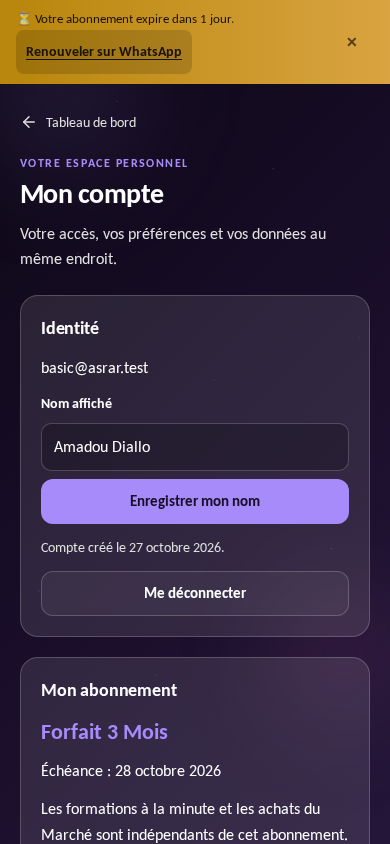
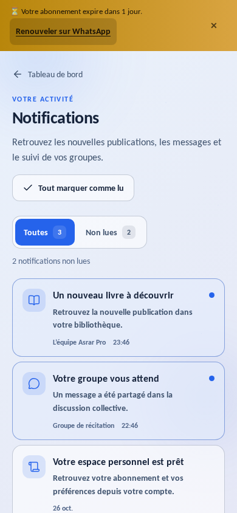
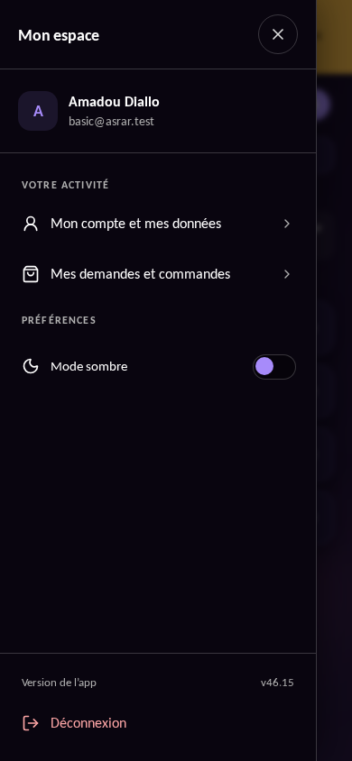
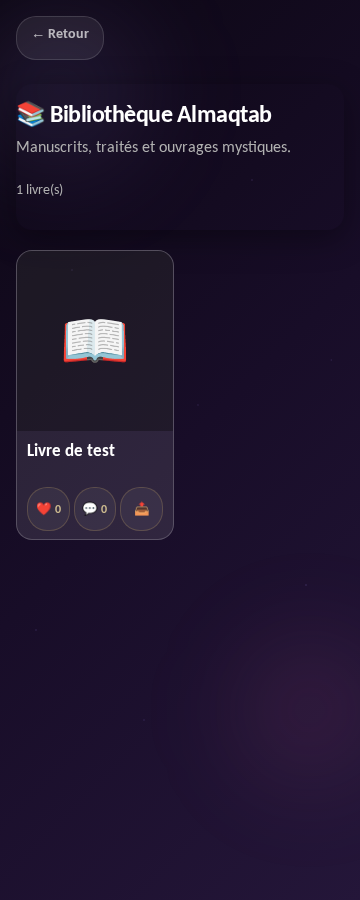
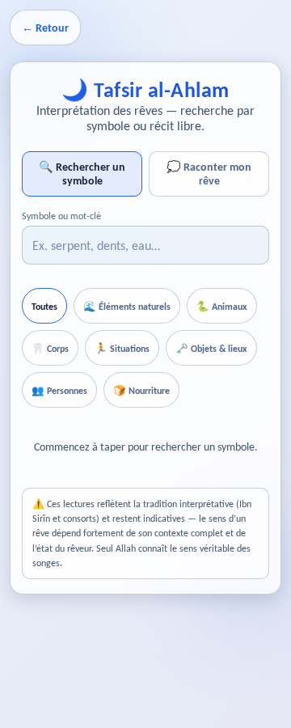
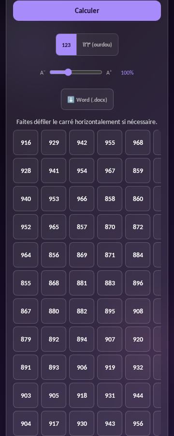
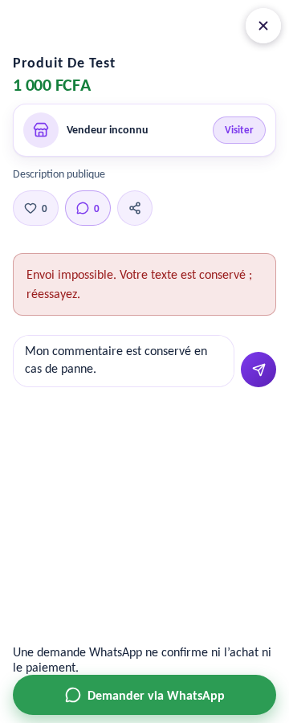

# Qualité des vues — revue des 35 vues

## Défauts constatés et corrections

| Défaut observé | Correction |
| --- | --- |
| Le rappel d’abonnement comprime son texte en colonne : le bouton de fermeture hérite de la largeur pleine page. | Largeurs explicites, rappel pleine largeur, texte lisible et fermeture de 44 × 44 px. |
| Menu personnel avec des liens sans repères, une petite bascule de thème et une version de repli sans rapport avec le build. | Identité, rubriques et icônes cohérentes, cibles tactiles de 44 px, pied de menu stable, version du build issue du SW si aucun contrôleur ne répond. |
| Compte, commandes et notifications avec des titres, retours et états d’attente différents. | En-tête et composant d’état partagés, retour visible sur téléphone, actions et espacements cohérents. |
| Échec initial des notifications masqué par un chargement sans fin. | Erreur visible, action Réessayer et récupération sans rechargement de l’application. |
| Marquage groupé affiché comme réussi même si l’API échoue. | Confirmation serveur avant rafraîchissement, conservation des non-lues après échec et message utile. |
| Historique difficile à parcourir. | Filtres Toutes / Non lues calculés localement, sans lectures Firebase supplémentaires au changement de filtre. |
| Messages de succès/erreur peu contrastés en thème clair. | Couleurs sémantiques distinctes selon le thème, focus clavier visible. |
| Discussion Zikr ignorant les marges injectées par Capacitor, réservant encore la hauteur de navigation quand le clavier la masque. | Variables de safe area partagées, compensation de navigation annulée au clavier et saisie qui grandit jusqu’à 120 px. |
| Retour vocal peu lisible et toast au niveau de la navigation. | Erreur audio persistante encadrée, récupération du vocal délimitée et toast au-dessus de la navigation. |
| Zoom utilisateur désactivé. | Retrait de maximumScale: 1 ; champs de saisie du chat en 16 px. |

La palette violette, la police Calibri/Carlito et les fonctions des modules sont
conservées. Les API, règles et autorisations ne sont pas modifiées par ce lot.
Le dialogue de confirmation reste ouvert pendant une requête en cours ; une
session expirée rend la reconnexion accessible hors de la fenêtre.

## Vérification

- Vues mobiles de 320 à 390 px, ordinateur 1440 px, thèmes clair et sombre.
- Rappel d’échéance, compte Basic, nom long en français et arabe, états vides,
  panne réseau simulée, reprise et échec du marquage des notifications.
- Navigation clavier, focus après fermeture et contrôle des débordements.
- Safe areas Android et ouverture du clavier simulées dans Chromium. Une
  vérification sur WebView Android réel reste nécessaire pour les particularités
  du clavier système et de la barre gestuelle.
- Scénarios dans `e2e/authenticated/ui-layout.spec.ts` ; suites publiques et
  authentifiées habituelles, lint, types, build et test du runtime Vercel.

Les captures de contrôle sont produites avec les comptes et données fictifs des
émulateurs. Elles ne contiennent pas de données de production.

## Périmètre du premier lot

Le premier lot a traité le socle et les parcours personnels. La revue du
28 octobre l’étend aux 35 vues listées ci-dessous et à plusieurs états métier.
Ce document décrit des observations et des contrôles, sans constituer une
certification d’accessibilité.

## Matrice de la revue du 28 octobre — v46.16

Chaque route a été ouverte dans le navigateur avec un compte fictif authentifié,
sur mobile 360 px et ordinateur 1440 px, en clair et en sombre : **140 captures
initiales**. Les contrôles de non-régression couvrent aussi le mobile 320 px.
Les API tierces sont bloquées pendant les tests ; leurs états de panne sont
contrôlés. Un affichage alimenté par une réponse tierce de recette n’est pas une
validation de disponibilité du service réel.

| Vue | Observation et traitement |
| --- | --- |
| `/` — Marché | Styles génériques isolés ; filtres et favoris agrandis. Fiche et boutique vendeur contrôlées avec titre long et image absente. |
| `/menu` | Recherche agrandie ; menu personnel et favoris conservés. |
| `/menu/spiritualite` | Retour de 44 px, titre et grille contrôlés. |
| `/menu/sciences-traditionnelles` | Retour de 44 px, badge Premium et libellés contrôlés. |
| `/menu/ressources` | Retour de 44 px et grille contrôlés. |
| `/menu/outils` | Retour de 44 px et grille contrôlés. |
| `/abajad` | Titre principal explicite, champ nommé, absence de focus forcé à l’ouverture ; résultats comparatifs contrôlés. |
| `/alqalam` | Police calligraphique locale ; sélection de mode, saisie et aperçu contrôlés. |
| `/asrar` | Retour visible et en-tête dans le flux ; erreur distincte d’une catégorie vide, reprise sans cache d’échec, ancienne réponse ignorée après changement rapide de catégorie. |
| `/bibliotheque` | Titres et auteurs visibles, couverture ouvrable au clavier, actions nommées ; texte de commentaire conservé après échec ; reprise du catalogue. |
| `/boutique` | Styles isolés ; formules accessibles, commandes nommées, confirmation de suppression, protection des saisies pendant envoi et erreurs persistantes. |
| `/combinaisons` | Champs reliés à leurs libellés, zones de saisie et accordéon agrandis ; texte arabe et résultats contrôlés. |
| `/commandes` | En-têtes, statuts, états vides et confirmation du premier lot vérifiés. |
| `/compte` | Identité, échéance, préférences et demandes de confidentialité du premier lot vérifiées. |
| `/formation` | Cartes accessibles au clavier ; titre de détail, retour et reprise après panne ; réservation contrôlée sans ouvrir Meet ou WhatsApp. |
| `/geomancie` | Saisie des Mères agrandie ; formulaire et écu contrôlés. |
| `/hijri` | Retour visible ; panne de source et action Réessayer contrôlées. |
| `/notifications` | États, filtres et reprise du premier lot vérifiés. |
| `/parrainage` | Commandes Copier et conditions agrandies ; état ouvert annoncé. |
| `/planete` | Repère principal, retour et choix de ville agrandis ; palette claire fixe conservée conformément au choix de design documenté dans le module. |
| `/rouwhania` | Retour visible ; formulaire, texte arabe et résultats contrôlés. |
| `/tafsir` | Filtres compacts et tactiles ; mode actif annoncé, saisie sans zoom forcé. |
| `/thalsams` | Filtres compacts, champs de 48 px, erreurs contrastées et détail tactile. |
| `/wafq` | Intentions compactes, commandes d’export tactiles ; grille bornée à la largeur disponible. |
| `/zikr` | Retour de liste restauré ; discussion, clavier et safe areas du premier lot vérifiés. |
| `/wafq/carre` | Retour et aide de 44 px ; portes de sélection contrôlées. |
| `/wafq/carre/3` | Modes compacts, saisie et carré calculé contrôlés ; défilement local si chiffres agrandis. |
| `/wafq/carre/4` | Saisie et carré calculé contrôlés. |
| `/wafq/carre/5` | Modes compacts, champs et carré calculé contrôlés. |
| `/wafq/carre/6` | Saisie et carré calculé contrôlés. |
| `/wafq/carre/7` | Saisie et carré calculé contrôlés. |
| `/wafq/carre/8` | Modes compacts, carré calculé et présentation du losange contrôlés. |
| `/wafq/carre/9` | Tableau défilant lisible ; consigne réécrite autour du calcul. |
| `/wafq/carre/10` | Tableau défilant lisible ; détails Java retirés de l’interface. |
| `/wafq/carre/11` | Tableau de 121 cases lisible, curseur jusqu’à 200 % et défilement au clavier. |

### Défauts transversaux corrigés

- Les feuilles du Marché, de la Bibliothèque et de la Boutique ciblaient
  `body`, `.container`, `.glass-panel` et des titres génériques : elles pouvaient
  changer une autre page après navigation côté client. Le préfixe `pm-` du
  Marché entrait aussi en collision avec Planète. Ces styles sont isolés.
- Des retours étaient masqués sous 900 px. Ils restent visibles et utilisables.
- Les filtres Tafsir, Thalsams et Wafq héritaient d’une largeur de 100 % et d’une
  marge de 15 px. Ils retrouvent leur largeur naturelle et des cibles de 44 px.
- Les grands carrés réduisaient ou cassaient leurs nombres pour tenir dans la
  page. Une zone défilante accessible conserve des cases suffisamment larges.
- Le rappel d’échéance défile avec la page et ne recouvre plus les en-têtes.
- Commentaires de produit et de secret, ainsi qu’avis : le texte reste présent
  après échec ; la saisie est vidée uniquement après confirmation serveur.
- La préférence de réduction des animations est respectée.

### Contrôles et limites

Les scénarios sont dans `e2e/authenticated/all-views.spec.ts`, en complément de
`ui-layout.spec.ts`. Ils contrôlent les 35 routes, les deux thèmes, le retour
mobile, le confinement des champs, les styles après navigation, les erreurs de
catalogue, les commentaires, les filtres, les neuf carrés et la suppression
vendeur. Les comptes et données proviennent uniquement des émulateurs.

Restent à valider sur appareil réel : clavier et marges des WebView Android,
lecteur PDF externe, partage système, audio, réception des alarmes et push.
Les exports volumineux et chaque variante mathématique ne sont pas tous couverts
par la recette visuelle ; leurs tests unitaires existants restent nécessaires.

## Aperçus du build compilé

Captures sur les émulateurs, avec des données fictives :

| Compte, thème sombre | Notifications, thème clair | Menu personnel |
| --- | --- | --- |
|  |  |  |

### Captures de la revue complète

| Bibliothèque | Filtres Tafsir | Carré 11 × 11 | Reprise d’un commentaire |
| --- | --- | --- | --- |
|  |  |  |  |

140 captures après correction et 22 captures de détail ont été examinées.
Aucune erreur JavaScript non interceptée n’a été observée dans ces captures.
Les quatre erreurs initiales d’Al-Qalam liées aux polices distantes ne
réapparaissent plus avec la police locale.
